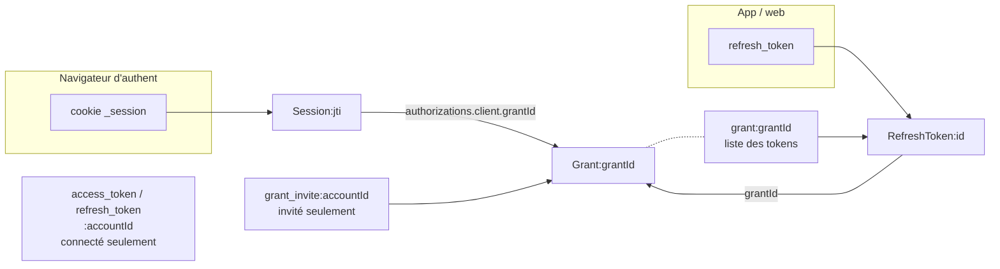

# Stockage Redis — entrées, objets OIDC, durées de vie

> Ce que connect stocke dans Redis, comment chaque entrée est retrouvée, et ce
> qui la fait disparaître. Déroulé d'un login : voir `flow-authentification.md`.

## Deux familles de tokens

connect est à la fois **client** des IdP externes et **serveur OIDC** de nos apps.
Redis contient donc deux familles de tokens à ne pas confondre :

| | Tokens IdP | Tokens connect |
|---|---|---|
| Émis par | i-milo, FT Connect, CD | connect (`oidc-provider`) |
| Détenus par | connect | app, web |
| Usage | appels aux API partenaires au nom de l'utilisateur (token exchange) | authentifier l'utilisateur auprès de l'api |
| Code | `TokenService` | `RedisAdapter` |
| Clé | `refresh_token:<accountId>` (snake_case) | `RefreshToken:<id>` (PascalCase) |

Toutes les clés portent le préfixe `oidc:` (`keyPrefix` ioredis, `redis.provider.ts`).
`accountId` = `TYPE|STRUCTURE|SUB`, ex. `JEUNE|MILO|e096fa16-…`, `JEUNE|INVITE|9e808de6-…`.

## Entrées

### Objets `oidc-provider` (`RedisAdapter`)

Identifiants aléatoires : on ne les retrouve **qu'à partir de ce que présente
le client** (cookie, token), ou d'un index.

| Clé | Type | TTL connecté | TTL invité | Trouvée à partir de |
|---|---|---|---|---|
| `Interaction:<uid>` | STRING | 1 h | 1 h | cookie `_interaction` |
| `AuthorizationCode:<id>` | HASH | 60 s | 60 s | `code` du callback |
| `Session:<jti>` | STRING | 42 j glissant | 42 j glissant | cookie `_session` |
| `uid:<uid>` | STRING → jti | = Session | = Session | index interne `oidc-provider` |
| `Grant:<grantId>` | STRING | 42 j | aucun | `grantId` (Session, RefreshToken, index) |
| `grant:<grantId>` | LIST de clés | max des tokens | aucun | `grantId` |
| `RefreshToken:<id>` | HASH | 42 j | aucun | `refresh_token` présenté |

- **Access token et ID token ne sont pas stockés** : JWT signés, vérifiés par
  signature (`accessTokenFormat: 'jwt'`). Un access token émis reste valide
  jusqu'à son `exp` (30 min), quoi qu'on supprime dans Redis.
- **Pas de rotation du refresh token** (`rotateRefreshToken: false`) : son TTL
  court depuis le login, pas depuis le dernier usage.
- **Session : TTL glissant**, ré-enregistrée pour 42 j à chaque requête qui la
  touche (`/authorize`…).
- **Clients non `native` (web, swagger)** : le refresh token est lié à la
  Session (`expiresWithSession`), il meurt avec elle. **App mobile** (`native`) :
  non, il lui survit.
- **HASH** pour les objets consommables (champ `consumed` ajouté à l'usage),
  **STRING** sinon.
- `grant:<grantId>` (minuscule) liste les clés des tokens du grant : c'est ce
  que lit `revokeByGrantId` pour tout supprimer d'un coup.

### Clés propres à connect (`RedisClient`)

| Clé | Type | TTL | Rôle |
|---|---|---|---|
| `access_token:<accountId>` | STRING | expiration IdP | token IdP |
| `refresh_token:<accountId>` | STRING | expiration IdP | token IdP |
| `access_token_lock:<accountId>` | STRING | 30 s | verrou de rafraîchissement du token IdP |
| `grant_invite:<accountId>` | STRING → grantId | aucun | index invité → grant, pour la suppression |
| `ContextStorage:<type>-<structure>-<clé>` | STRING | aucun | cache de config IdP, **global** (pas par utilisateur) |

## Ce qu'un utilisateur a dans Redis



| | Connecté (MiLo, FT, CD) | Invité |
|---|---|---|
| Session + `uid` | oui, 42 j glissant | oui, 42 j glissant |
| Grant + liste + RefreshToken | oui, 42 j | oui, **sans TTL** |
| Tokens IdP + lock | oui | non (pas d'IdP) |
| `grant_invite` | non | oui, sans TTL |

## Cas d'utilisation

| Cas | Ce que présente le client | Lecture | Écriture / suppression |
|---|---|---|---|
| Login (callback IdP) | cookie `_interaction` | `Interaction` | + tokens IdP, + `Grant`, + `Session`, + `AuthorizationCode` (+ `grant_invite` si invité) |
| Échange du code | `code` + PKCE | `AuthorizationCode` | code `consumed`, + `RefreshToken` |
| Refresh | `refresh_token` | `RefreshToken`, `Grant`, `findAccount` (api) | — (pas de rotation) |
| `/authorize` avec session | cookie `_session` | `Session`, `findAccount` | nouveau `AuthorizationCode` |
| Token exchange (api) | JWT api | tokens IdP `:accountId` | tokens IdP si rafraîchis |
| Logout (`/logout`) | cookie `_session` | `Session` | web : − grant du client et ses tokens ; app : rien (voir ci-dessous) |
| Suppression de compte (`DELETE /accounts/:idAuth`) | `idAuth` seul | `grant_invite`, `KEYS *idAuth*` | − tokens IdP ; invité : − `Grant`, − `RefreshToken`, − index |

**Suppression de compte**, appelée par l'api (archivage, suppression, purge
invités) : l'api ne transmet que le `sub`, alors qu'aucun objet `oidc-provider`
ne contient le `sub` dans sa clé. Sans index, connect ne peut pas les retrouver :

- connecté : `Grant`, `RefreshToken`, `Session` **restent** jusqu'à leur TTL
  (42 j) ;
- invité : `grant_invite` donne le grant → révocation complète ; la `Session`
  reste (42 j).

Ce qui reste est **inutilisable dès que l'api ne trouve plus le compte** : à
chaque refresh ou `/authorize`, `findAccount` appelle `GET /auth/users/:sub` ;
un 404 donne `invalid_grant` (refresh) ou un nouveau login (session).

Exception : un **invité repris** existe encore côté api jusqu'à la purge
quotidienne (job `PURGER_INVITES_INACTIFS`, 6h). D'ici là, son refresh token
obtient toujours des access tokens, et l'api les accepte.

**Logout** : un grant est révoqué au logout sauf s'il est marqué
`persistsLogout`, ce qui est le cas des clients `native` (app). Le refresh token
de l'app survit donc au logout. Par ailleurs, notre page de logout soumet le
formulaire en JS (`form.submit()`), qui n'envoie pas `logout=yes` : la Session
n'est alors pas détruite, seule l'autorisation du client est retirée (branche
`state.clientId` de `end_session.js`).

## Inspecter un utilisateur (redis-cli)

Les clés contiennent `|` : toujours les quoter.

```bash
# invité : grant → tokens
GET 'oidc:grant_invite:JEUNE|INVITE|<sub>'
LRANGE 'oidc:grant:<grantId>' 0 -1
GET 'oidc:Grant:<grantId>'
HGETALL 'oidc:RefreshToken:<id>'

# connecté : tokens IdP
GET 'oidc:refresh_token:JEUNE|MILO|<sub>'

# Session d'un utilisateur : aucun index, scan du contenu (lent, éviter en prod)
redis-cli --scan --pattern 'oidc:Session:*' | while read -r k; do
  redis-cli GET "$k" | grep -q '<sub>' && echo "$k"
done
```

`SCAN` renvoie des pages : continuer tant que le curseur n'est pas `0`
(ou utiliser `redis-cli --scan`).
